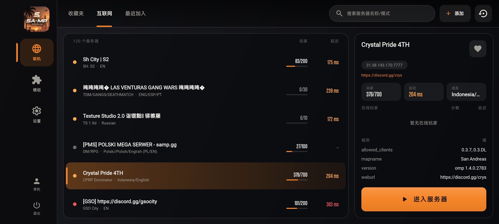
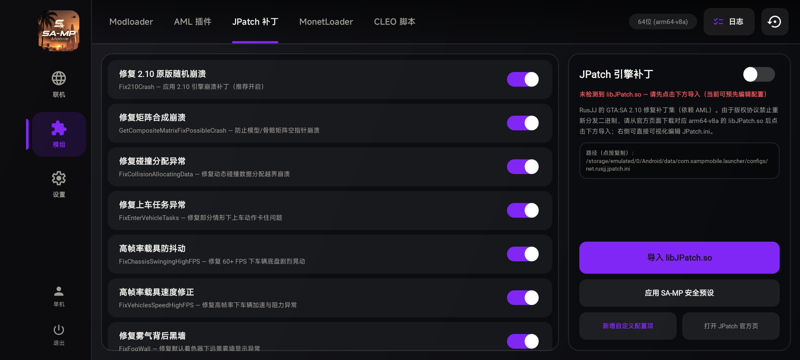
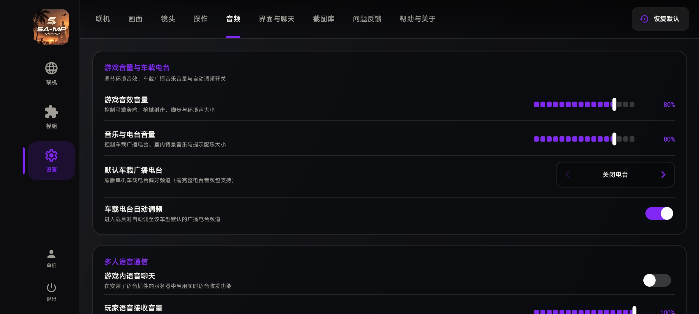
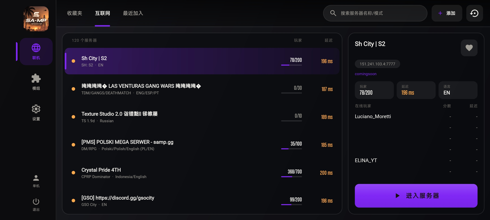

# SA-MP Mobile

**English | [简体中文](README.zh-CN.md)**

An Android SA-MP multiplayer client for **GTA: San Andreas Android v2.10** (Java launcher + C++ native library `libSAMPMOBILE.so`), supporting both `arm64-v8a` and `armeabi-v7a` builds.

> See [NOTICE](NOTICE) for copyright, third-party components and compliance information.



---

## Overview

This project continuously evolves from the open-source Alyn SA-MP Mobile architecture. For modern Android (up to **Android 14 / 15, SDK 35**) it delivers **a full launcher rewrite, a rebuilt foundation of the native protocol and engine layers, broad and deep SA-MP / `open.mp` behavioral parity, coexistence of a five-in-one mod ecosystem, and end-to-end stability hardening**.

The client is designed around one principle: **"strictly match PC SA-MP / `open.mp` behavior — never break the multiplayer protocol or anti-cheat contract for the sake of mobile adaptation."** For everything involving core synchronization, combat determination, vehicle state machines, single-player residue suppression and server anti-cheat compatibility, the reference baselines are the `open.mp` upstream source code, official documentation, and disassembly of `libGTASA.so` (arm64 / arm32). Mobile-side engineering adaptation is limited to touch interaction, Android window/process isolation, a high-resolution Chinese font atlas, and modern system security policies.

This project is maintained on an irregular basis, stays fully open and transparent, and contains no hidden logic or private features. The repository ships no game assets or commercial fonts — all runtime files are extracted by users from their own copy of the game. You are welcome to build, modify and fork it; derivative versions must be open-sourced under the same **GNU GPL v3.0** license. If you run into problems, please file an Issue.

---

## Resource Preparation

For copyright compliance, this repository provides only source code and open-source dependencies. Before building and running the client from scratch, prepare the following external resources:

| Resource | Description | Required | How to provide / use |
|---|---|---|---|
| **GTA:SA Android v2.10 installation package** | Source of `libGTASA.so`, `libImmEmulatorJ.so` and the lightweight APK assets (supports standard ~26 MB APKs, Split APKs and 2 GB+ combined APKs; large assets are skipped automatically) | Required to build the APK | Install it on your phone and run `prepare_gtasa.py --from-adb`, or put the APK into `dist/` with a filename starting with `gtasa` (e.g. `gtasa_2.10_arm64.apk`) and run `prepare_gtasa.py` once (naming rules in "Extract GTA:SA v2.10 runtime files" below) |
| **GTA:SA Android v2.10 game data** | Provides the ~2.4 GB single-player base map, models, animations and textures (a plain ~26 MB APK does not include this data; it requires the `.obb` files; extract `.xapk`/`.apks` first) | Required to build the data package | Put the `main`/`patch` `.obb` (or the 2 GB+ full `.apk`) directly into the root-level `dist/`; the script auto-detects them in `main` → `patch` order |
| **PC GTA:SA + SA-MP 0.3.7** | Provides `SAMP.img`, `SAMP.ide`, `SAMPCOL.img` and the PC TextDraw textures (no third-party mobile repack needed) | Required to build the data package | Pass the PC installation directory via `--pc-samp` when running `build_gamedata.py` |
| **Open-source Chinese font** (e.g. Noto Sans SC) | Generates `SAMP/fonts/chinese.ttf` for Chinese text rendering | Optional (recommended for Chinese servers) | Put it into `dist/` with `font` in the filename (`.ttf` / `.ttc` / `.otf` supported); if omitted, the bundled Roboto is used as fallback |

> **Notes on GTA:SA Android v2.10:**
> - Google Play has since updated to v2.11+, whose low-level memory layout is incompatible with this client — you must use **v2.10**.
> - `tools/engine/prepare_gtasa.py` automatically detects and strips the Fastman92 injection (`libFastman92pluginLoader.so`) found in common patched v2.10 packages, restoring the original `JNI_OnLoad`/`JNI_OnUnload`.
> - Such patched packages also relocate the *program header table* of `libGTASA.so` to the end of the file. Real devices load it fine, but x86 emulators (LDPlayer etc.) crash instantly when loading such a library — the game closes the moment it starts. The script automatically moves it back to the standard location during extraction; no extra steps are needed. The official unmodified `libGTASA.so` does not have this problem and is left untouched.
> - **If your `libGTASA.so` was extracted before 2026-11-23** (before the script gained the step above), it will crash on emulators. Re-run the extraction once and rebuild.
> - If the package only contains 64-bit `arm64-v8a` (no 32-bit `armeabi-v7a`), modern 64-bit phones can still build and run it; the build check only prints a notice and does not block.

---

## Build Environment

| Tool / Component | Version requirement | Notes |
|---|---|---|
| **JDK** | **17 – 21** (JDK 21 recommended) | Gradle 8.13 does not support JDK 25+ (`major version 69` error) |
| **Android SDK** | `compileSdk 35` / `targetSdk 35` / `minSdk 24` | Platform 35 and Build-Tools 35 required |
| **Android NDK** | **`25.1.8937393`** | Pinned in `app/build.gradle` |
| **CMake** | **`3.22.1`** (or compatible) | Can be installed via Android Studio SDK Manager |
| **Gradle** | **8.13** (Wrapper included in repo) | No global installation needed |
| **Python 3** | 3.10+ | For the `tools/` scripts; `build_gamedata.py` requires `numpy` |

---

## Build & Deployment Workflow

### 1. Clone the repository and configure `local.properties`

```bash
git clone https://github.com/XiaoNiaoa/samp-mobile.git
cd samp-mobile
cp local.properties.example local.properties
```

Fill in your local Android SDK path in `local.properties` (opening the project in Android Studio generates this automatically):

```properties
# Windows
sdk.dir=C\:\\Users\\<YourUser>\\AppData\\Local\\Android\\Sdk

# macOS / Linux
# sdk.dir=/Users/<YourUser>/Library/Android/sdk
```

### 2. Extract the GTA:SA v2.10 runtime files

This step extracts the native libraries and lightweight assets from the GTA:SA v2.10 installation package into the project (the target paths are in `.gitignore`).

#### The simplest way

1. Put the GTA:SA v2.10 APK into the `dist/` folder at the repository root.
2. Rename it so the filename starts with `gtasa` (rules below).
3. Run once in the repository root:

```bash
python tools/engine/prepare_gtasa.py
```

Whether `dist/` contains one APK or several, **run this exactly once** — do not run it once per APK.

#### APK naming rules

When run without arguments, the script locates APKs automatically by these rules:

| Rule | Description |
|---|---|
| Location | Must sit directly inside `dist/`; APKs in subfolders are not found |
| Extension | Must be `.apk` (extract the inner `.apk` from `.xapk` / `.apks` first) |
| Filename | Must start with `gtasa`, case-insensitive; the rest of the name is free-form |
| Count | Unlimited — all matching APKs are processed together in a single run |

Examples:

| Filename | Found? |
|---|---|
| `dist/gtasa_2.10.apk` | Yes |
| `dist/gtasa_2.10_arm64.apk`, `dist/gtasa_2.10_arm32.apk` | Yes, both processed together |
| `dist/GTASA-v2.10.apk` | Yes (case-insensitive) |
| `dist/GTA SA v2.10 64-bit.apk` | No (starts with `GTA SA`, not `gtasa`) |
| `dist/apk/gtasa_2.10.apk` | No (inside a subfolder) |

Other files in `dist/` (`.obb`, `gamedata.zip`, fonts, etc.) are unaffected — the script never touches them.

The `arm64` / `arm32` in filenames are just for humans; the script does not rely on the filename to determine bitness — it opens the APK and inspects which architectures the libraries inside are built for.

#### When you have two APKs (32-bit and 64-bit split)

Some distributions ship 32-bit and 64-bit as two separate APKs. Put both into `dist/`, name them per the rules, and run the script once — libraries of both bitnesses will be extracted.

- Multiple APKs are processed in alphabetical filename order.
- When the same library exists in several APKs, the first one encountered wins; later copies are skipped.
- Assets are merged: for same-named files, the APK processed later takes precedence.
- A 64-bit-only APK is fine too — modern 64-bit phones are covered; the script will note the missing 32-bit libraries, which you can ignore.

#### Other extraction methods

```bash
# Manually specify APKs or a Split-APK directory (filenames are not subject to the rules above; list multiple APKs in one command)
python tools/engine/prepare_gtasa.py --apk dist/gtasa_2.10_arm32.apk dist/gtasa_2.10_arm64.apk

# If GTA:SA v2.10 is already installed on your phone (no need to import the single-player data package), extract directly over ADB
python tools/engine/prepare_gtasa.py --from-adb

# Clean up locally extracted proprietary files (including the backups mentioned below)
python tools/engine/prepare_gtasa.py --clean
```

#### What the script does during extraction

1. Copies `libGTASA.so` (and the 32-bit `libImmEmulatorJ.so`) into `app/src/main/jniLibs/<ABI>/`.
2. If `libGTASA.so` comes from a Fastman92-patched package: removes its loader injection and moves the program header table back to the standard location (the latter is needed to run on x86 emulators — see "Notes on GTA:SA Android v2.10" above).
3. Copies the APK's lightweight assets into `app/src/main/assets/`. This step **wipes** previously extracted content in that directory before writing anew.

Optional flag `--libs-only`: performs only the first two steps, leaving `app/src/main/assets/` untouched. Useful when assets were already extracted and you only want to refresh the native libraries. It can be combined with any of the methods above:

```bash
python tools/engine/prepare_gtasa.py --libs-only
```

Other behavior:

- If an extracted library is identical to the one already in `jniLibs`, it is not rewritten; if it differs, the old file is first backed up to `build/gtasa-backup/<ABI>/` and then replaced.
- Rebuild the APK (next step) for the extraction to take effect.

#### Troubleshooting

- **`No APK given and no dist/gtasa*.apk found`**: there is no rule-compliant APK in `dist/` — check location, extension and filename prefix against the table above.
- **`No lib/arm64-v8a/libGTASA.so or lib/armeabi-v7a/libGTASA.so found`**: this APK contains no game library — you probably picked the wrong file (e.g. an installer shell, or a non-ABI split of a Split APK).
- **`WARNING: SHA-256 differs from verified v2.10`**: the library does not exactly match the verified official v2.10. Patched packages trigger this warning and usually still work; if the game misbehaves, try a v2.10 package from another source.
- **Instant crash when entering the game on an emulator**: your `libGTASA.so` was extracted with an older version of the script. Re-run the extraction once and rebuild.

### 3. Build the APK

The debug build needs no signing configuration or `google-services.json`; the output goes to `app/build/outputs/apk/debug/samp.apk`:

```powershell
# Windows (PowerShell) — if your default JDK is >= 25, point JAVA_HOME to JDK 17–21 first
# $env:JAVA_HOME = "C:\Path\To\jdk-21"
.\gradlew.bat assembleDebug
```

```cmd
:: Windows (CMD)
set JAVA_HOME=C:\Path\To\jdk-21
gradlew.bat assembleDebug
```

```bash
# macOS / Linux
./gradlew assembleDebug
```

> For a source/C++-only dry-run compile check (without extracted GTA:SA files), add `-PskipGtasaCheck=true`.
>
> - **Release signing (optional)**: configure `SAMP_STORE_FILE`, `SAMP_STORE_PASSWORD`, `SAMP_KEY_ALIAS`, `SAMP_KEY_PASSWORD` in `local.properties` or environment variables, then run `./gradlew assembleRelease` (never commit keystore files).
> - **Firebase Crashlytics (optional)**: place `app/google-services.json` following `app/google-services.json.example` to enable it automatically; disabled by default.

### 4. Generate the data package (`.zip`) and one-tap import in the launcher

1. Put the GTA:SA v2.10 `main`/`patch` `.obb` (or the 2 GB+ full `.apk`) into the repository-root `dist/`;
2. (Optional) put a Chinese font (e.g. `font.ttf` / `font.ttc` / `font.otf`) into `dist/`;
3. Point the script at your PC GTA:SA directory with **SA-MP 0.3.7** installed and run a single command to generate `dist/gamedata.zip`:

```bash
python tools/gamedata/build_gamedata.py --pc-samp "D:\Program Files (x86)\Rockstar Games\GTA San Andreas"
```

> Optional arguments: `--gtasa` (manually specify OBB/APK paths), `--cjk-font` (manually specify the font), `--out` (defaults to `dist/gamedata.zip`; pass a directory path to output loose files), `--keep-audio` (keep full audio), `--scm-dir` (replace scripts).

**One-tap import on the phone:**
1. Copy `dist/gamedata.zip` to any directory on the phone (e.g. `Download/`) — no need to touch `Android/data/` manually;
2. Install and open `SA-MP Mobile`, then pick the file via **设置 (Settings) → 文件验证 (File Verification) → 本地导入 (Local Import)** — the launcher UI is currently Chinese-only; if the data package is incomplete, the「缺少游戏数据包」("Missing game data package") dialog shown when joining a server also offers a「一键导入 .zip」("One-tap .zip import") button;
3. The launcher streams and extracts it into its own `files/` directory, preserving your existing `settings.json` and server list — completely sidestepping Android 14 directory permission and path nesting pitfalls.

### 5. Custom launcher backdrop (optional)

Put a landscape image named `launcher_backdrop.jpg` (`.png` / `.webp` also work) into `app/src/main/res/drawable-nodpi/` and rebuild to replace the default gradient backdrop; delete the file to restore the default.

- Recommended size **2400×1080** (20:9); other aspect ratios are center-cropped to fill. Roughly the leftmost 1/10 of the image is covered by the navigation bar — keep the subject away from there.
- The filename must be all lowercase and unique (no two extensions of it may coexist in the directory).
- A darkening scrim and a translucent panel are layered over the image to keep text readable; adjust opacity via `ui_backdrop_scrim` (scrim) and `ui_glass` (panel) in `res/values/colors.xml`.

---

## Local Verification & Testing

Without any device or emulator, the unified entry point `tests/check.py` runs 5 stages of objective verification and automated tests (see [tests/README.md](tests/README.md) for details):

- **Dual-ABI compile-time layout guards**: `app/src/main/cpp/SAMPMOBILE/AbiGuards.cpp` verifies pointer width, RakNet types, SA-MP sync packet sizes and GTA:SA core engine struct layouts when compiling `arm64-v8a` / `armeabi-v7a`.
- **Unified verification entry (integrating NDK `llvm-nm`/`llvm-readelf` and Android SDK `aapt2`/`zipalign`/`apksigner`)**:

  ```bash
  # Daily quick check (compliance, platform contracts, dual-ABI ELF/537 symbol table/DT_NEEDED/real JNI exports, APK tool verification)
  python tests/check.py

  # Full verification (adds C++ host-side unit tests, Gradle JVM unit tests, gamedata chunk round-trip)
  python tests/check.py --full

  # Strict pre-release gate (requires GTA:SA + APK, adds official Android Lint checks)
  python tests/check.py --release
  ```

- **Run the C++ host-side unit tests separately** (WSL / Linux): `sh tests/native/run.sh` (covers protocol primitives, input arbitration, config contracts and differential comparison against `open.mp` upstream source).
- **Run the Gradle JVM unit tests separately**: `./gradlew testDebugUnitTest`

---

## Screenshots







---

## FAQ

- **Error `Unsupported class file major version 69`**: your current `JAVA_HOME` is JDK 25+ — switch to JDK 17–21 and rebuild.
- **AML / MonetLoader loading issues on Android 14+**: keep `useLegacyPackaging = true` in `app/build.gradle` and `android:allowNativeHeapPointerTagging="false"` in `AndroidManifest.xml`.
- **Slow first Gradle dependency fetch**: `settings.gradle` already configures mirror fallbacks after the official repositories.

---

## License & Disclaimer

The original and modified code of this project is open-sourced under the **GNU General Public License v3.0**; the full license text is in [LICENSE](LICENSE), and the third-party component license list is in [third_party/licenses/THIRD_PARTY_NOTICES.md](third_party/licenses/THIRD_PARTY_NOTICES.md).

This project continues development based on the open-source Alyn SA-MP Mobile architecture and retains the original file attribution notices. This project is not affiliated with Rockstar Games, Take-Two Interactive or the official SA-MP team in any way, and distributes no Rockstar proprietary binaries, game data packages or commercial fonts — see [NOTICE](NOTICE) for details.
