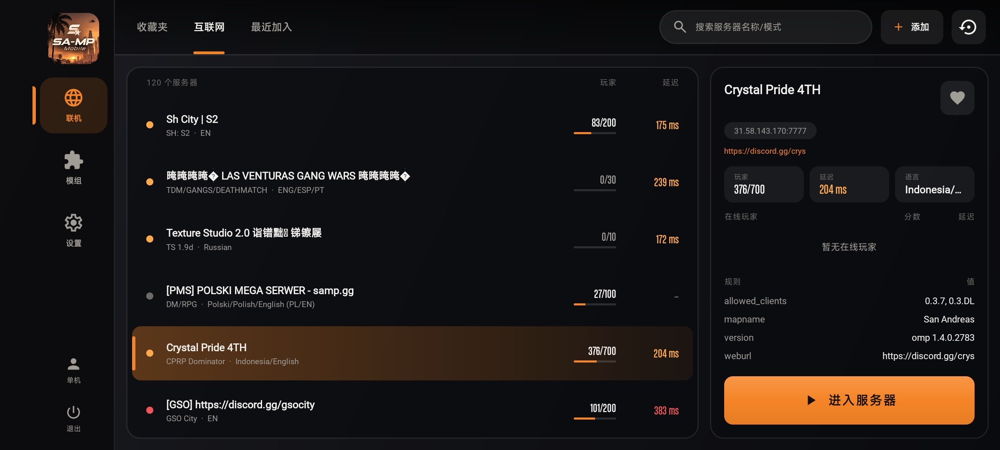
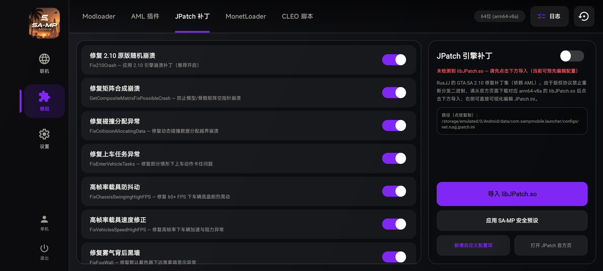
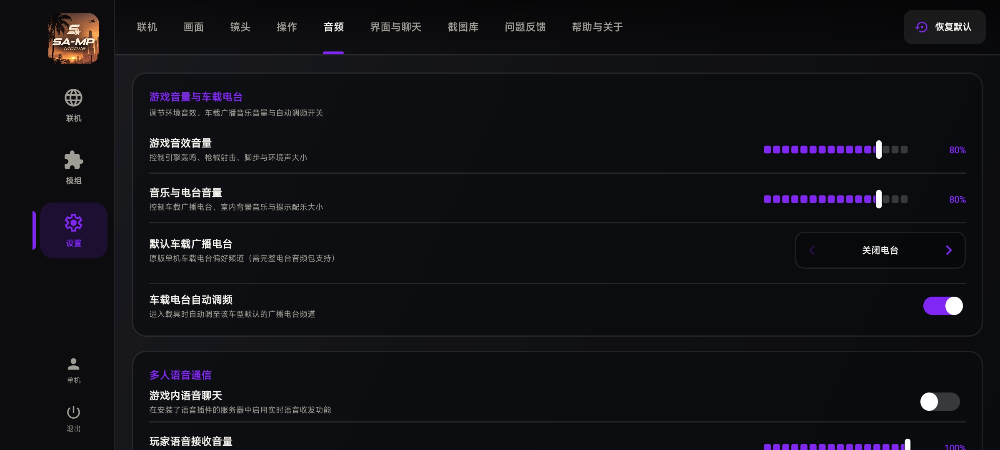
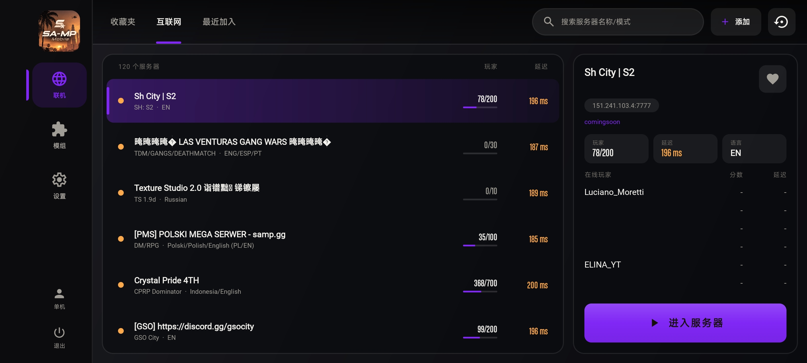

# SA-MP Mobile

**[English](README.md) | 简体中文**

面向 **GTA: San Andreas Android v2.10** 的 Android SA-MP 联机客户端（Java 启动器 + C++ 原生库 `libSAMPMOBILE.so`），支持 `arm64-v8a` 与 `armeabi-v7a` 双架构构建。

> 版权、第三方组件与合规声明请参阅 [NOTICE](NOTICE)。



---

## 项目简介

本项目基于开源的 Alyn SA-MP Mobile 架构持续演进，面向现代 Android（支持至 **Android 14 / 15，SDK 35**）完成了**启动器全面重写、原生协议层与引擎层地基重构、SA-MP / `open.mp` 广度与深度行为对齐、五合一模组生态共存以及全链路稳定性加固**。

客户端设计追求**「向 PC 端 SA-MP / `open.mp` 行为严格对齐，不为移动化而破坏联机协议与反作弊契约」**：凡涉及核心同步、战斗判定、载具状态机、单机残留屏蔽与服务器反作弊兼容的环节，均以 `open.mp` 上游源码、官方文档及 `libGTASA.so`（arm64 / arm32）反汇编作为对照基准；仅针对触屏交互、Android 窗口/进程隔离、高分辨率中文字库图集与现代系统安全策略做移动侧工程适配。

本项目不定期维护更新，坚持完全开放与透明，不含任何隐藏逻辑或私有功能；仓库内不包含任何游戏资源与商业字体，运行时文件均由用户从个人游戏拷贝中自行提取。欢迎自由构建、修改与 Fork，衍生版本需遵循相同的 **GNU GPL v3.0** 协议开源。如在使用中发现问题，欢迎提交 Issue 反馈。

---

## 资源准备

出于版权合规要求，本仓库仅提供源码与开源依赖。从零构建并运行客户端前，请先准备以下外部资源：

| 资源 | 说明 | 是否必需 | 放置 / 使用方式 |
|---|---|---|---|
| **GTA:SA Android v2.10 安装包** | 提取 `libGTASA.so`、`libImmEmulatorJ.so` 及轻量 APK 资产（支持标准 ~26 MB APK、Split APK 及 2 GB+ 整合 APK，脚本会自动跳过大资源） | 编译 APK 必需 | 安装到手机后执行 `prepare_gtasa.py --from-adb`，或把 APK 放进 `dist/` 并让文件名以 `gtasa` 开头（如 `gtasa_2.10_arm64.apk`），执行一次 `prepare_gtasa.py`（命名规则见下文「提取 GTA:SA v2.10 运行时文件」） |
| **GTA:SA Android v2.10 游戏数据** | 提供 ~2.4 GB 单机基础地图、模型、动画与贴图（普通 ~26 MB APK 不含此数据，需配 `.obb`；`.xapk`/`.apks` 先解压） | 构建数据包必需 | 将 `main`/`patch` `.obb`（或 2 GB+ 完整 `.apk`）直接放入根目录 `dist/`，脚本按 `main` → `patch` 自动识别 |
| **PC 版 GTA:SA + SA-MP 0.3.7** | 提供 `SAMP.img`、`SAMP.ide`、`SAMPCOL.img` 与 PC TextDraw 贴图（无需第三方手机整合包） | 构建数据包必需 | 执行 `build_gamedata.py` 时通过 `--pc-samp` 指定本机安装目录 |
| **开源中文字体**（如 Noto Sans SC） | 生成 `SAMP/fonts/chinese.ttf` 以支持中文显示 | 可选（中文服推荐） | 放入 `dist/` 并命名为含 `font` 的字体文件（支持 `.ttf` / `.ttc` / `.otf`），省略则回退为自带 Roboto |

> **关于 GTA:SA Android v2.10 的说明：**
> - Google Play 现已更新至 v2.11+，底层内存布局与本客户端不兼容，请务必使用 **v2.10**。
> - `tools/engine/prepare_gtasa.py` 会自动识别并剥离常见 v2.10 补丁包中的 Fastman92 注入（`libFastman92pluginLoader.so`），还原原版 `JNI_OnLoad`/`JNI_OnUnload`。
> - 这类补丁包还把 `libGTASA.so` 内部的「程序头表」挪到了文件末尾。真机能正常加载，但 x86 模拟器（雷电等）加载这种库会立刻崩溃，表现为进游戏瞬间闪退。脚本提取时会自动把它挪回标准位置，不需要额外操作。官方原版的 `libGTASA.so` 没有这个问题，脚本不会改动它。
> - **如果 `libGTASA.so` 是 2026-11-23 之前提取的**（那时脚本还没有上面这一步），在模拟器上会闪退。重新执行一次提取、再重新编译即可。
> - 若安装包仅含 64 位 `arm64-v8a`（缺少 32 位 `armeabi-v7a`），现代 64 位手机仍可直接编译运行，构建校验仅作提示不会拦截。

---

## 编译环境

| 工具 / 组件 | 版本要求 | 说明 |
|---|---|---|
| **JDK** | **17 – 21**（推荐 JDK 21） | Gradle 8.13 不支持 JDK 25+（会报 `major version 69`） |
| **Android SDK** | `compileSdk 35` / `targetSdk 35` / `minSdk 24` | 需安装 Platform 35 与 Build-Tools 35 |
| **Android NDK** | **`25.1.8937393`** | 已在 `app/build.gradle` 中固定 |
| **CMake** | **`3.22.1`**（或兼容版本） | 可通过 Android Studio SDK Manager 安装 |
| **Gradle** | **8.13**（仓库自带 Wrapper） | 无需全局安装 |
| **Python 3** | 3.10+ | 运行 `tools/` 脚本；`build_gamedata.py` 需安装 `numpy` |

---

## 构建与部署流程

### 1. 克隆仓库并配置 `local.properties`

```bash
git clone https://github.com/XiaoNiaoa/samp-mobile.git
cd samp-mobile
cp local.properties.example local.properties
```

在 `local.properties` 中填入本机 Android SDK 路径（用 Android Studio 打开工程会自动生成）：

```properties
# Windows
sdk.dir=C\:\\Users\\<YourUser>\\AppData\\Local\\Android\\Sdk

# macOS / Linux
# sdk.dir=/Users/<YourUser>/Library/Android/sdk
```

### 2. 提取 GTA:SA v2.10 运行时文件

这一步把 GTA:SA v2.10 安装包里的原生库和轻量资产提取到工程里（目标路径已加入 `.gitignore`）。

#### 最简单的做法

1. 把 GTA:SA v2.10 的 APK 放进仓库根目录的 `dist/` 文件夹。
2. 把文件名改成以 `gtasa` 开头（规则见下）。
3. 在仓库根目录执行一次：

```bash
python tools/engine/prepare_gtasa.py
```

不管 `dist/` 里有一个还是多个 APK，**都只执行这一次**，不要每个 APK 各执行一遍。

#### APK 命名规则

脚本不带参数运行时，按下面的规则自动找 APK：

| 规则 | 说明 |
|---|---|
| 位置 | 必须直接放在 `dist/` 下，子文件夹里的不会被找到 |
| 扩展名 | 必须是 `.apk`（`.xapk`、`.apks` 要先解压出里面的 `.apk`） |
| 文件名 | 必须以 `gtasa` 开头，大小写都可以；后面写什么随意 |
| 数量 | 不限，所有符合条件的 APK 会在同一次运行里一起处理 |

例子：

| 文件名 | 能否被找到 |
|---|---|
| `dist/gtasa_2.10.apk` | 能 |
| `dist/gtasa_2.10_arm64.apk`、`dist/gtasa_2.10_arm32.apk` | 能，两个一起处理 |
| `dist/GTASA-v2.10.apk` | 能（不区分大小写） |
| `dist/GTA SA v2.10 64-bit.apk` | 不能（开头是 `GTA SA`，中间有空格，不是 `gtasa`） |
| `dist/apk/gtasa_2.10.apk` | 不能（在子文件夹里） |

`dist/` 里的其他文件（`.obb`、`gamedata.zip`、字体等）不受影响，脚本不会碰。

文件名里的 `arm64`、`arm32` 只是给人看的，脚本不靠文件名判断位数，而是打开 APK 看里面有哪个位数的库。

#### 有两个 APK（32 位和 64 位分开）时

有些安装包把 32 位和 64 位分成两个 APK。两个都放进 `dist/` 并按规则命名，然后执行一次脚本即可，两个位数的库都会被提取。

- 多个 APK 按文件名的字母顺序依次处理。
- 同一个库在多个 APK 里都有时，用最先遇到的那个，后面的跳过。
- 资产（`assets`）是合并的：同名文件以排在后面的 APK 为准。
- 只有 64 位的 APK 也可以，现代 64 位手机够用；这时脚本会提示缺少 32 位的库，可以忽略。

#### 其他提取方式

```bash
# 手动指定 APK 或 Split-APK 目录（文件名不受上面规则限制；多个 APK 写在同一条命令里）
python tools/engine/prepare_gtasa.py --apk dist/gtasa_2.10_arm32.apk dist/gtasa_2.10_arm64.apk

# 手机上已装好 GTA:SA v2.10（无需导入单机数据包），连接 ADB 直接从手机提取
python tools/engine/prepare_gtasa.py --from-adb

# 清理本地提取的专有文件（含下面提到的备份）
python tools/engine/prepare_gtasa.py --clean
```

#### 脚本提取时做了什么

1. 把 `libGTASA.so`（以及 32 位的 `libImmEmulatorJ.so`）放到 `app/src/main/jniLibs/<ABI>/`。
2. 如果 `libGTASA.so` 来自带 Fastman92 补丁的安装包：去掉它的加载器注入，并把程序头表挪回标准位置（后者是为了能在 x86 模拟器上运行，原因见上面「关于 GTA:SA Android v2.10 的说明」）。
3. 把 APK 里的轻量资产放到 `app/src/main/assets/`。这一步会**先清空**该目录里原有的提取内容再重新写入。

可选参数 `--libs-only`：只做前两件事，不动 `app/src/main/assets/`。适用于资产已经提取过、只想更新原生库的情况。它可以和上面任何一种方式一起用：

```bash
python tools/engine/prepare_gtasa.py --libs-only
```

其他行为：

- 提取出的库与 `jniLibs` 里现有的完全相同时不会重写；不同时先把旧文件备份到 `build/gtasa-backup/<ABI>/` 再替换。
- 提取完要重新编译 APK（下一步）才会生效。

#### 常见问题

- **提示 `No APK given and no dist/gtasa*.apk found`**：`dist/` 里没有符合命名规则的 APK，对照上面的表检查位置、扩展名和文件名开头。
- **提示 `No lib/arm64-v8a/libGTASA.so or lib/armeabi-v7a/libGTASA.so found`**：这个 APK 里没有游戏库，通常是拿错了文件（例如只是一个安装器外壳，或 Split APK 里的非 ABI 分包）。
- **提示 `WARNING: SHA-256 differs from verified v2.10`**：这个库和已核对过的官方 v2.10 不完全一样。带补丁的安装包会出现这条提示，一般不影响使用；如果进游戏后异常，换一个来源的 v2.10 安装包。
- **模拟器上进游戏瞬间闪退**：`libGTASA.so` 是用旧版脚本提取的。重新执行一次提取，再重新编译。

### 3. 编译 APK

Debug 包无需签名配置或 `google-services.json`，产物输出至 `app/build/outputs/apk/debug/samp.apk`：

```powershell
# Windows (PowerShell) — 若默认 JDK >= 25，先指定 JDK 17–21
# $env:JAVA_HOME = "C:\Path\To\jdk-21"
.\gradlew.bat assembleDebug
```

```cmd
:: Windows (CMD)
set JAVA_HOME=C:\Path\To\jdk-21
gradlew.bat assembleDebug
```

```bash
# macOS / Linux
./gradlew assembleDebug
```

> 仅做源码/C++ 干跑编译检查（未提取 GTA:SA 文件）时可加 `-PskipGtasaCheck=true`。
>
> - **Release 签名（可选）**：在 `local.properties` 或环境变量中配置 `SAMP_STORE_FILE`、`SAMP_STORE_PASSWORD`、`SAMP_KEY_ALIAS`、`SAMP_KEY_PASSWORD` 后执行 `./gradlew assembleRelease`（切勿提交密钥文件）。
> - **Firebase Crashlytics（可选）**：参考 `app/google-services.json.example` 放置 `app/google-services.json` 即可自动启用，默认关闭。

### 4. 生成数据包（`.zip`）并在启动器一键导入

1. 将 GTA:SA v2.10 的 `main`/`patch` `.obb`（或 2 GB+ 完整 `.apk`）放入仓库根目录 `dist/`；
2. （可选）将中文字体（如 `font.ttf` / `font.ttc` / `font.otf`）放入 `dist/`；
3. 指定已安装 **SA-MP 0.3.7** 的 PC 版 GTA:SA 目录，执行一条命令即可自动生成 `dist/gamedata.zip`：

```bash
python tools/gamedata/build_gamedata.py --pc-samp "D:\Program Files (x86)\Rockstar Games\GTA San Andreas"
```

> 可选参数：`--gtasa`（手动指定 OBB/APK 路径）、`--cjk-font`（手动指定字体）、`--out`（默认 `dist/gamedata.zip`，传目录路径则输出散文件夹）、`--keep-audio`（保留完整音频）、`--scm-dir`（替换脚本）。

**手机端一键导入：**
1. 将 `dist/gamedata.zip` 复制到手机任意目录（如 `Download/`），无需手动操作 `Android/data/`；
2. 安装并打开 `SA-MP Mobile`，在 **设置 → 文件验证 → 本地导入** 选择该文件；若数据包不完整，点击进服时弹出的「缺少游戏数据包」对话框中也有「一键导入 .zip」按钮可直接导入；
3. 启动器会自动流式解压至自身 `files/` 目录，同时保留已有 `settings.json` 与服务器列表，彻底规避 Android 14 目录权限与层级错位问题。

### 5. 自定义启动器背景（可选）

把一张横向图片命名为 `launcher_backdrop.jpg`（`.png` / `.webp` 亦可）放进 `app/src/main/res/drawable-nodpi/` 后重新编译，即替换默认渐变背景；删除该文件即恢复默认。

- 建议尺寸 **2400×1080**（20:9），其他比例按居中裁切铺满；画面最左侧约 1/10 会被导航栏盖住，主体别放在那里。
- 文件名必须全小写且只留一份（同目录不能同时存在两种扩展名）。
- 图片上方叠有一层压暗遮罩与半透明面板以保证文字可读，透明度在 `res/values/colors.xml` 的 `ui_backdrop_scrim`（遮罩）与 `ui_glass`（面板）调整。

---

## 本地自动校验与测试

不依赖真机或模拟器即可通过统一入口 `tests/check.py` 执行 5 阶段客观校验与自动化测试（详见 [tests/README.md](tests/README.md)）：

- **双 ABI 编译期布局守卫**：`app/src/main/cpp/SAMPMOBILE/AbiGuards.cpp` 在编译 `arm64-v8a` / `armeabi-v7a` 时校验指针宽度、RakNet 类型、SA-MP 同步包大小及 GTA:SA 核心引擎结构体布局。
- **统一校验入口（集成 NDK `llvm-nm`/`llvm-readelf` 与 Android SDK `aapt2`/`zipalign`/`apksigner`）**：

  ```bash
  # 日常快检（合规、平台契约、双 ABI ELF/537 符号表/DT_NEEDED/真实 JNI 导出、APK 工具校验）
  python tests/check.py

  # 全量校验（追加 C++ 电脑端单测、Gradle JVM 单测、gamedata 分片闭环）
  python tests/check.py --full

  # 发包前严格门禁（强制要求 GTA:SA + APK，并追加官方 Android Lint 检查）
  python tests/check.py --release
  ```

- **单独运行 C++ 电脑端单测**（WSL / Linux）：`sh tests/native/run.sh`（覆盖协议基元、输入仲裁、配置契约及与 `open.mp` 上游源码的对拍）。
- **单独运行 Gradle JVM 单测**：`./gradlew testDebugUnitTest`

---

## 界面预览







---

## 常见问题

- **报错 `Unsupported class file major version 69`**：当前 `JAVA_HOME` 为 JDK 25+，请切换至 JDK 17–21 后重新构建。
- **Android 14+ 加载 AML / MonetLoader 异常**：请保留 `app/build.gradle` 中的 `useLegacyPackaging = true` 与 `AndroidManifest.xml` 中的 `android:allowNativeHeapPointerTagging="false"`。
- **首次拉取 Gradle 依赖较慢**：`settings.gradle` 已在官方源后配置镜像回退。

---

## 许可证与免责声明

本项目原始及修改代码采用 **GNU General Public License v3.0** 开源发布，协议全文见 [LICENSE](LICENSE)，第三方组件许可证清单见 [third_party/licenses/THIRD_PARTY_NOTICES.md](third_party/licenses/THIRD_PARTY_NOTICES.md)。

本项目基于开源的 Alyn SA-MP Mobile 架构继续开发，保留原有文件归属声明。本项目与 Rockstar Games、Take-Two Interactive 或 SA-MP 官方团队无任何关联，不分发任何 Rockstar 专有二进制、游戏数据包或商业字体，详情见 [NOTICE](NOTICE)。
